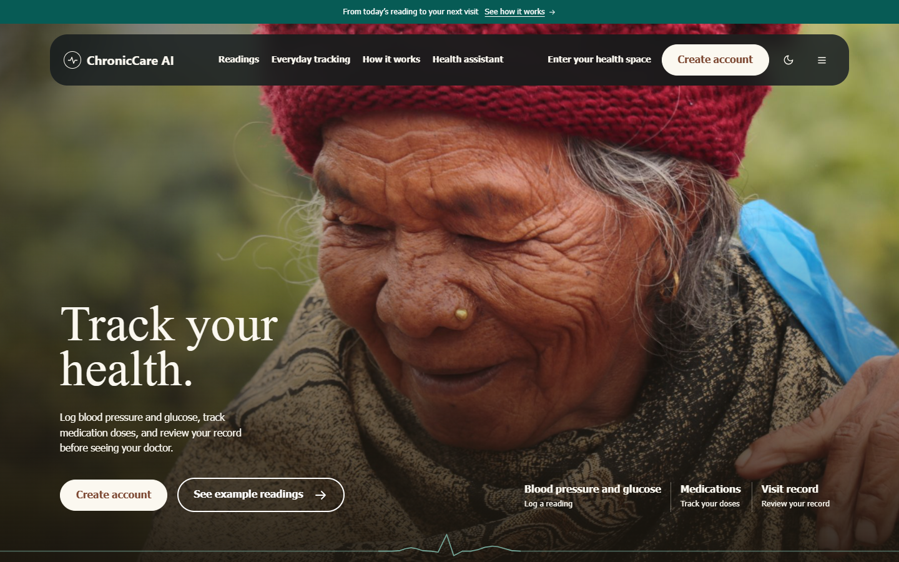
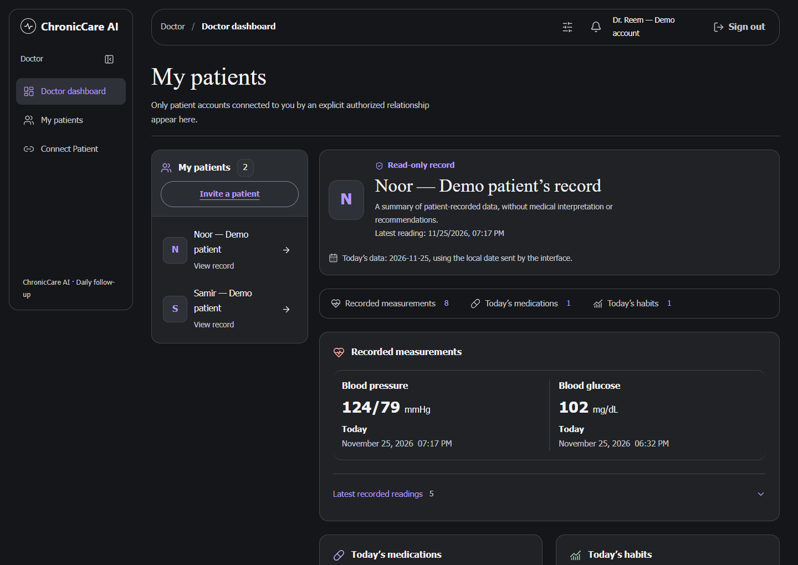
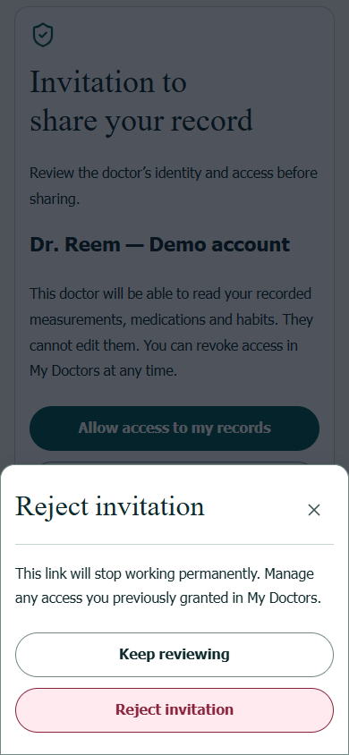

# ChronicCare AI

**A patient-controlled health-tracking web application**

Graduation project · Alhassan Heloo · [Live production site](https://chroniccare-ai-api.onrender.com/) · [Repository](https://github.com/Alhassan-heloo/chroniccare-ai)

## Problem and solution

A health journal is most useful when the patient can record daily activity, recover the time and units of a reading, and decide when to share a record. ChronicCare AI brings measurements, medication schedules and habits into a bilingual workspace. A patient can prepare a visit summary and give a doctor explicit, revocable read-only access. An admin workspace handles account setup. A separate educational assistant offers an optional provider-backed interaction.

**Evidence of delivery** · The public site is deployed from `bb99da73326d5a513343b001f4050105729a051b`. The release review covered a PostgreSQL upgrade rehearsal, a separately verified production migration, role and consent integration, and public surface smoke checks. [Evidence and scope](FINAL-PROJECT-STATUS.md)

## Engineering the product

| Area | Implemented work visible in the repository |
| --- | --- |
| Frontend | React 19, TypeScript, Vite, TanStack Query, React Router and Recharts support role-specific screens, cached requests, charts, local dates and explicit success/error states. React Hook Form and Zod support input validation. |
| UI and UX | Arabic RTL and English LTR layouts, responsive navigation, light/dark states, keyboard focus and named consent actions. The invitation UI exposes dismissal, confirmation, final rejection and replay outcomes. |
| Backend | Express 5 services use role checks, validation, stable API error responses and explicit PostgreSQL access. Patient, doctor and admin capabilities are backed by separate routes and data scopes. |
| Storage | PostgreSQL migrations organize measurements, medication schedules and dose logs, habits and progress, account tokens, sessions and consent. Constraints preserve state; the ledger captures SHA-256 checksums and serializes migration execution. |
| Security | Argon2 password hashes, HttpOnly sessions, origin and CSRF checks, scoped records, limited read rights for doctors, and serialized access decisions. The production deployment uses TLS for transport and a separate reviewed database-migration procedure. |
| AI and delivery | A bounded educational question and language reach a configured OpenAI or Groq adapter. Email and Firebase Cloud Messaging are optional external integrations. |
| Validation and release | Node test runner, Postgres integration, Playwright/Edge, static quality checks, a compatibility rehearsal and a Render/Neon production rollout. |

## Engineering challenges and decisions

**Make consent durable.** A preview resolves no relationship. The invitation's opaque token is hashed in storage. Approval/rejection use one patient lock and a row lock. Both consume the link, and only approval writes consent. The rejection column and constraint let a previously deployed build continue treating rejected links as consumed.

**Keep the displayed record tied to the right patient.** The doctor screen keys queries to account/patient context, checks returned record identity and resets stale or unavailable views. The server's consent-scoped queries remain the authority on who can read.

**Keep operations defensible.** The same-origin deployment made the built UI and API share the HTTPS/session boundary. Migration 018 was checked with historical invitation states, then applied before the app deploy. The release kept the existing service and preserved an app-level fallback build compatible with the new schema.

**Limit what the assistant can do.** The UI retains a temporary display conversation. The server sends one question with language and fixed educational instructions, limits provider usage and returns an explicit failure when unavailable. The assistant's implementation supports an educational workflow; clinical efficacy, factual accuracy and live provider quality were outside verification.

## Individual work and external contributions

**Repository attribution.** Git history credits `Alhassan-heloo` for the commits reviewed on the release ancestry. Traceable examples include [graduation experience and invitations](https://github.com/Alhassan-heloo/chroniccare-ai/commit/355fa1a), [explicit patient consent](https://github.com/Alhassan-heloo/chroniccare-ai/commit/17c78fc), [permanent rejection](https://github.com/Alhassan-heloo/chroniccare-ai/commit/bb99da73326d5a513343b001f4050105729a051b), [assistant backend](https://github.com/Alhassan-heloo/chroniccare-ai/commit/2a5e020) and [same-origin deployment](https://github.com/Alhassan-heloo/chroniccare-ai/commit/8fa3b89). The portfolio byline uses the requested name **Alhassan Heloo**. Use first-person statements for work personally performed.

**Shared and external work.** The application uses open ecosystem libraries and hosted services, and it credits third-party visual and font assets in its design notes. Review the byline with any collaborators, supervisors or reviewers and name their specific contribution when confirmed. Git commit bylines establish repository attribution; research, design feedback, supervision and informal collaboration have no separate attribution record in the materials reviewed. [Asset credits](apps/frontend/homepage-hybrid/DESIGN.md)

## Ready-to-adapt public copy

### CV achievement statements

- Built a bilingual React and Express graduation application with PostgreSQL-backed health logs, role-specific dashboards and printable visit summaries.
- Implemented patient-controlled, revocable doctor access and one-time invitation decisions with transactional concurrency controls and database constraints.
- Verified a compatible schema rollout and an on-commit Render deployment using PostgreSQL integration, browser and public HTTPS checks.
- Added a provider-configured educational AI interface with bounded requests, explicit failure handling and separation from the patient-record queries.

### LinkedIn project description

ChronicCare AI is my bilingual graduation project for daily health tracking and consent-based sharing. It combines a React/TypeScript interface, an Express API and PostgreSQL. Patients log readings, doses and habits, then choose whether a doctor can view their records. I documented the security model, tested invitation replay and concurrency with synthetic data, and verified a same-origin Render release. The assistant is designed for general education. [Try the public site](https://chroniccare-ai-api.onrender.com/)

### GitHub repository description

Bilingual React, Express and PostgreSQL graduation project for health tracking, revocable patient-to-doctor sharing, and a configurable educational assistant.

### نبذة عربية

مشروع تخرج يتيح تسجيل القياسات والجرعات والعادات، ويمنح المريض قرار مشاركة سجله للقراءة فقط. يبرز العمل هندسة واجهة عربية وإنجليزية، وتفويضًا قائمًا على الموافقة، واختبارات تكامل على PostgreSQL، ونشرًا موثّقًا على Render. لا تتضمن دراسة الحالة ادعاءً بفعالية سريرية أو قياسًا لتحسّن صحة المرضى.

[Public-safe screenshot set and diagrams](docs/release-assets/README.md) · [Graduation demo](GRADUATION-DEMO.md)
