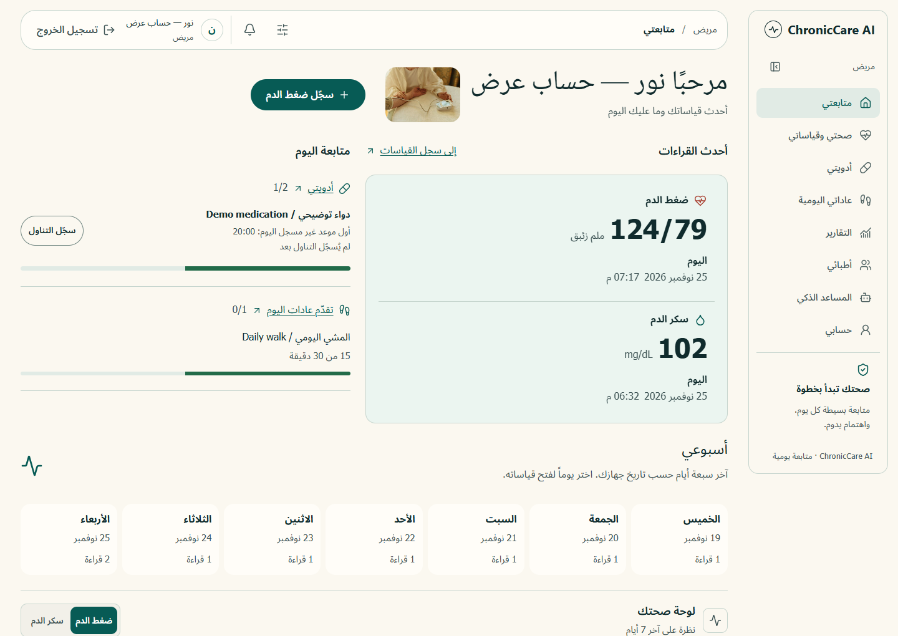
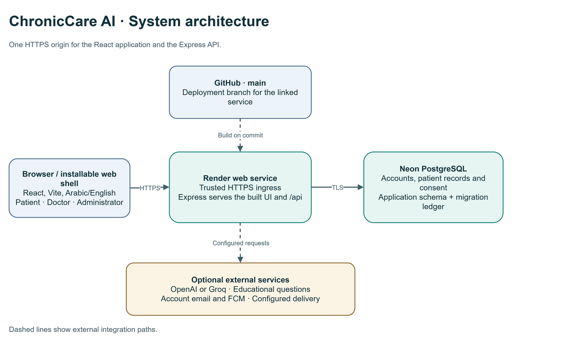

# ChronicCare AI

A bilingual graduation project for everyday health tracking and patient-controlled sharing. Patients record readings and routines. Doctors see a read-only record after explicit consent. Administrators manage doctor accounts.

**Production** · [Open ChronicCare AI](https://chroniccare-ai-api.onrender.com/)

**Release candidate** · v1.0.0 · `bb99da73326d5a513343b001f4050105729a051b`

**Project byline** · Alhassan Heloo · [GitHub commit history](https://github.com/Alhassan-heloo/chroniccare-ai/commits/main/)

> Graduation software for tracking and education. Clinical validation and regulatory certification are outside the project's scope.

## Overview

The patient records blood pressure or glucose, follows a medication schedule, tracks daily habits and prepares a printable visit summary. Values retain their units and time. The doctor sees a selected patient's available records only while the patient has approved access. Arabic and English are available across role workspaces, with RTL/LTR layout, light/dark appearance and responsive navigation.

*Local render of the application UI with fictional API responses. [Public screenshot set and provenance](docs/release-assets/README.md).*

| Role | Capabilities |
| --- | --- |
| Patient | Register and sign in, track readings, medications/doses and habits, review trends, manage doctor consent, and ask the educational assistant where configured. |
| Doctor | Activate an invited or directly provisioned account, change a temporary password if required, issue connection invitations and open approved patients' read-only records and recent activity. |
| Administrator | Manage doctor account creation, invitations and disablement. Clinical access requires a doctor role with patient consent. |

## Stack and architecture

| Layer | Technology |
| --- | --- |
| Interface | React 19, TypeScript 5.9, Vite 7, React Router 7, TanStack Query 5, Axios, Tailwind CSS 4, React Hook Form, Zod and Recharts. |
| Server | Node.js, Express 5, `pg`, Argon2, Helmet, explicit CORS and request limits. |
| Data | PostgreSQL on Neon, parameterized SQL and versioned migrations. |
| Delivery and AI | Optional account-email transport, Firebase Cloud Messaging for browser push, and a server-side OpenAI or Groq assistant adapter. |
| Verification and hosting | Node test runner, isolated PostgreSQL, Playwright with Edge, GitHub and a Render Web Service. |

Express serves the compiled frontend at `/` and the API at `/api` on the same Render origin. Local development uses Vite on `5173` and Express on `3001` by default. The database holds user sessions, patient records and consent. External integrations are configured separately from this core flow. [Editable system diagram](docs/release-assets/diagrams/system-architecture.drawio) · [Deployment architecture](docs/render-same-origin.md)

### Database

Most tables live in `chroniccare`. The patient domain contains `measurements`, `medications` with schedules and dose logs, and `habits` with daily progress. `users`, `sessions` and `account_tokens` support identity and recovery. `doctor_patient_relationships` stores access approval, while `patient_invitations` and `doctor_connection_codes` support two separate connection methods. Notifications, browser registrations and push jobs have their own tables. Foreign keys, uniqueness and CHECK constraints reinforce the API's ownership, timing and state rules. The migration runner records filenames and SHA-256 hashes in `public.chroniccare_schema_migrations` and serializes migration execution with a transaction-scoped advisory lock.

[Database relationship diagram](docs/release-assets/diagrams/database-relationships.drawio) · [SQL migrations](apps/backend/migrations/)

### Authentication and consent

Passwords are hashed with Argon2. Browser sessions use HttpOnly cookies with Secure on the deployed HTTPS origin, SameSite=Lax, idle and absolute expiry, and server-side session checks. Browser writes require a trusted origin and a CSRF token. PostgreSQL queries scope patient records by ownership and doctor access by current patient approval. The server checks the expected role independently of the UI route guard.

1. A doctor issues a targeted ten-minute link. Only the intended signed-in patient can review it. Preview shows the doctor identity and grants zero record access.
2. **Close review** dismisses the UI. **Approve** consumes the link and grants read-only access. **Reject invitation** consumes that link permanently and preserves any earlier approval.
3. **Revoke access** removes the live relationship in My Doctors. A consumed link cannot restore access. Approval, rejection and revocation use transactional locks to serialize a patient's decisions.
4. The separate manual code flow is also supported and requires patient approval. The code is a privately shared bearer artifact and is not bound to a specific patient at issuance.

[Consent flow diagram](docs/release-assets/diagrams/invitation-consent.drawio) · [Connection rules and responses](docs/patient-connections.md) · [Account and session architecture](docs/production-account-foundation.md)

### Educational assistant

An authenticated patient sends a message and language to `POST /api/assistant/messages`. The server enforces bounded input, attempt limits, timeouts and output validation. When configured, it sends the question and fixed educational instructions to OpenAI or Groq. The server supplies the disclaimer and emergency guidance. The application does not query patient records for the assistant. Conversation state lives in the browser view, and earlier turns are not forwarded. Free text may still carry details typed by the patient, so use fictional or general questions in demos. Provider-side retention and response quality require a separate assessment.

[Assistant backend design](docs/ai-assistant-backend.md) · [Assistant interface](docs/ai-assistant-frontend.md) · [Current provider adapter](apps/backend/src/assistant/provider.ts)

## Local development

Use Node.js **24 LTS**, npm and a local PostgreSQL server. The packages have independent lockfiles. Commands below use PowerShell at the repository root.

~~~powershell
npm.cmd --prefix apps/backend ci
npm.cmd --prefix apps/frontend ci
if (-not (Test-Path 'apps/backend/.env')) {
  Copy-Item 'apps/backend/.env.example' 'apps/backend/.env'
}
~~~

Create a privately credentialed PostgreSQL role and a dedicated **local** development database using the [backend setup instructions](apps/backend/README.md#initialize-local-postgresql). Set `DATABASE_URL` in the ignored backend `.env` to that local database. If using different ports/origins, keep `CORS_ORIGINS` aligned and set the frontend's public `VITE_API_URL`. Keep all secret values server-side and out of Git.

**For the newly configured local development database only**, verify the destination before initializing its schema.

~~~powershell
npm.cmd --prefix apps/backend run db:check
npm.cmd --prefix apps/backend run db:migrate
npm.cmd --prefix apps/backend run dev
~~~

In a second terminal:

~~~powershell
$env:VITE_API_URL = 'http://127.0.0.1:3001/api'
npm.cmd --prefix apps/frontend run dev -- --host 127.0.0.1 --strictPort
~~~

Keep the browser and API on the same local hostname. Adjust the API port in that command if you changed the backend port. Use the account setup guide for role provisioning. On Windows, `start-dev.bat` can start an already configured stack. The launcher performs readiness checks and leaves installations, account setup and schema changes to the operator. [Local application](http://127.0.0.1:5173/) · [Local account setup](docs/account-setup.md)

## Testing

~~~powershell
npm.cmd --prefix apps/backend run typecheck
npm.cmd --prefix apps/backend run lint
npm.cmd --prefix apps/backend run build
npm.cmd --prefix apps/frontend run typecheck
npm.cmd --prefix apps/frontend run lint
npm.cmd --prefix apps/frontend run build
npm.cmd --prefix apps/frontend test
npm.cmd --prefix apps/frontend run test:api-base
~~~

Run `npm.cmd --prefix apps/backend test` with a separate disposable `TEST_DATABASE_URL` ending in `_test` to include database integrations. Without this environment setting, database-dependent cases can be skipped. Preserve existing databases and use a fresh disposable database when a suite requires an initially empty schema.

The browser suites require Microsoft Edge, Playwright and, for real-service suites, the documented isolated PostgreSQL setup. Set `PLAYWRIGHT_MODULE_PATH` if Playwright is supplied by a local tooling installation. `npm.cmd --prefix apps/frontend run test:assistant-browser` uses mocked responses. The `test:final-integration` wrapper provisions a loopback PostgreSQL test database and applies the schema there. [Demo and rehearsal setup](GRADUATION-DEMO.md#setup-and-fallback)

The release review recorded **116 backend checks** passing and **20 production-style HTTPS checks** passing, alongside focused Edge suites for invitations, connections, doctor/admin and authentication. See the [test evidence and limitations](FINAL-PROJECT-STATUS.md#verification-carried-forward) for precise scope and the incomplete legacy suite.

## Production, security and limitations

The existing Render Web Service builds both packages and runs `npm --prefix apps/backend start`. The public readiness probe is `GET /api/health/ready`. GitHub `main` is configured for on-commit deployment. Migration 018 was separately applied and verified before this application release. The running service has no pre-deploy migration command. Use the [deployment guide](docs/render-same-origin.md) and [release acceptance checklist](FINAL-ACCEPTANCE.md) for separate schema and application release decisions.

Keep production database TLS in `verify-full`, use a limited database role for runtime operations, and keep credentials, backups, private reports and live patient records out of demos and Git. HTTP readiness reports connectivity. The migration ledger is a separate source of schema evidence.

The software supports record keeping and education. It has no clinical validation, medical device certification or measured health outcome evidence. Production verification covered public readiness, navigation and anonymous access denial. Live authenticated workflows, paid AI calls, email/push deliverability and physical-device behavior were tested only where identified in the [status report](FINAL-PROJECT-STATUS.md).

Earlier interface phases are preserved in the [design history](docs/living-evolution-redesign.md), [graduation implementation notes](docs/graduation-experience.md) and [README at the deployed commit](https://github.com/Alhassan-heloo/chroniccare-ai/blob/bb99da73326d5a513343b001f4050105729a051b/README.md).

## Credits and presentation

Git history attributes the reviewed release to **Alhassan Heloo** under `Alhassan-heloo`. See the [portfolio contribution boundaries](PORTFOLIO-CASE-STUDY.md#individual-work-and-external-contributions) and [asset credits](apps/frontend/homepage-hybrid/DESIGN.md) for credit details. The repository has no project-wide license in the reviewed tree. Third-party assets and libraries retain their own terms.

**نبذة عربية** · ChronicCare AI مشروع تخرج ثنائي اللغة لمتابعة القراءات والأدوية والعادات ومشاركة السجل مع الطبيب بعد موافقة صريحة من المريض. يضم المشروع لوحة مريض، وعرضًا للطبيب للقراءة فقط، وإدارة حسابات الأطباء، ومساعدًا للتثقيف الصحي. الصور المعروضة تستخدم بيانات خيالية.

[Release notes](RELEASE-NOTES-v1.0.0.md) · [Graduation presentation](GRADUATION-DEMO.md) · [Portfolio](PORTFOLIO-CASE-STUDY.md) · [Final acceptance](FINAL-ACCEPTANCE.md)
